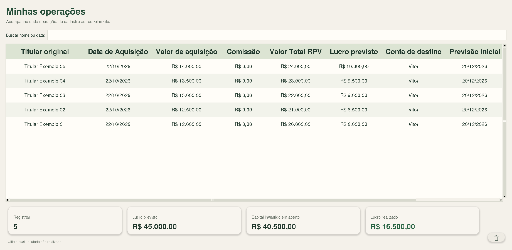

# Gestor de RPV — 0.16.1

Aplicativo pessoal para Windows, em Python com Tkinter e SQLite. Cada computador
mantém seus próprios dados, sem servidor ou sincronização. Não exige pacotes extras.

## Executar e atualizar no Windows

Baixe em **Code → Download ZIP**, extraia **todos os arquivos** e abra `app.py`.
Se precisar ver uma mensagem de erro, abra o Prompt de Comando nessa pasta:

```bat
python app.py
```

Mantenha `app.py`, `dados.py`, `componentes.py`, `contas.py`, `interacao.py`, `tema.py`, `calculadora.py`, `backup.py`, `ordenacao.py`, `selecao.py`, `documentos.py`, `visual.py` e `versao.py` juntos.
A tela inicial tem os botões **Nova entrada**, **Minhas operações**,
**Contas de recebimento** e **Sair**. A assinatura **Vitoran Tech · v0.16.1** aparece no canto inferior direito.
O número é lido da versão do programa e acompanha cada atualização.
As janelas abrem centralizadas; o histórico abre maximizado no Windows.

## Identidade visual Moss

Visual inspirado em verde floresta, sálvia e marfim, com uma versão escura em tons
verdes profundos. O botão **Modo escuro / Modo claro**, com ícones de lua e sol, alterna a
aparência; o menu **Exibir** do histórico oferece as mesmas opções.

- Tela inicial com três cartões de ações e ícones desenhados em Python, sem numeração.
  A assinatura Vitoran Tech fica somente no rodapé.
- Temas e fontes reutilizados, com renderização das sombras otimizada para agilizar a alternância.
- Cantos arredondados, sombras discretas e verde nas ações principais.
  Os botões não mostram retângulo tracejado após o clique; a navegação por
  teclado e a ativação pela barra de espaço continuam disponíveis.
- Fonte Segoe UI no Windows, com alternativas locais em outros sistemas.
- Minhas operações com cabeçalhos de 18 pontos e entradas de 12 pontos,
  linhas alternadas e quatro indicadores em cartões alinhados.
  Lucro realizado é o último cartão, à direita, inclusive no layout com duas linhas.
- Cadastro de entradas e contas com rolagem e botões fixos no rodapé, inclusive em telas menores.
  A roda do mouse rola os campos; navegar pelo teclado revela o campo em foco.
- Calendários, anexos, contas, calculadora e menus acompanham os dois temas.
- As imagens de interface são geradas pelo próprio Python. Não é necessário instalar
  pacotes, baixar fontes ou manter uma pasta externa de recursos para executar.




[Ver a prévia do modo escuro](docs/historico-escuro.png)

## Barra de menus do histórico

- **Arquivo → Nova entrada**: abre o cadastro de uma RPV.
- **Arquivo → Contas de recebimento**: administra os dados bancários.
- **Editar → Editar registro / Excluir registro**: edita uma linha ou envia as selecionadas à lixeira.
- **Exibir → Tema claro / Tema escuro**: muda o tema de todas as janelas,
  inclusive formulários, calendários, menus de contexto e calculadora.
  A escolha vale durante a execução; o aplicativo inicia no tema claro inspirado na paleta Moss.
- **Calculadora**: abre uma calculadora independente, sem modificar o cadastro.
  Faz soma, subtração, multiplicação, divisão, porcentagem, troca de sinal e
  apagamento. Aceita vírgula, teclado, Enter para calcular e Esc para limpar.
  As operações são sequenciais, como em uma calculadora básica.

Os antigos botões de ações do histórico foram movidos para essa barra.
A busca continua acima da tabela. Os menus de clique direito permanecem disponíveis.

## Contas de recebimento

A lista usa fonte de 12 pontos, dois pontos maior que o padrão da interface,
com altura das linhas e largura da janela ajustadas para a leitura.

- Vitor e Lilian aparecem inicialmente sem dados bancários inventados. Use
  **Ver / Editar** para completar os cadastros.
- **Cadastrar nova conta** permite informar identificação, nome completo, endereço,
  número, cidade, estado, banco, agência, conta e chave Pix.
  O estado é selecionado pela sigla em uma lista com as 27 UFs, incluindo DF. O CPF é obrigatório e deve ser válido. O mesmo CPF pode ser usado em várias contas bancárias distintas. Cadastros antigos sem CPF aparecem como **⚠ Completar cadastro**,
  em vermelho, e precisam ser completados ao editar.
- Identificação, chave Pix e combinação banco/agência/conta não podem se repetir,
  inclusive entre contas desativadas. Endereços podem ser iguais.
  Use o mesmo nome de banco nos cadastros para uma comparação consistente.
- **Remover** pede confirmação e apaga o cadastro bancário, mesmo quando já usado
  em operações. As entradas continuam existentes e preservam o nome e a cópia
  dos dados bancários guardados na aquisição. A edição oferece a conta removida
  como referência histórica e também permite selecionar uma conta ativa.
- Somente a célula **Situação** de uma conta incompleta fica vermelha e em negrito;
  nome e banco mantêm a cor normal.
- **Desativar / Reativar** preserva os registros antigos. Contas desativadas não
  aparecem em novas entradas; continuam disponíveis na edição da RPV que já as usa.
- Cada nova operação guarda uma cópia dos dados de recebimento. Alterar uma conta
  não reescreve essa cópia nas operações antigas. O botão **Dados de recebimento**
  do registro permite consultar os dados preservados. Para copiá-los, clique
  com o botão direito sobre os dados e escolha **Copiar**.
- A migração só conhece os dados existentes na versão antiga (Vitor ou Lilian).
  Não preenche retroativamente os dados bancários desconhecidos dos registros antigos.

## Cadastro e histórico

- Nomes completos ganham iniciais maiúsculas enquanto você digita, inclusive
  após espaços. Endereços também ganham iniciais maiúsculas em cada palavra.
  Identificação, banco, busca e observações começam com maiúscula. Chaves Pix e identificadores bancários mantêm sua escrita original.
- O rótulo **Valor de aquisição** não repete o símbolo R$; a máscara monetária
  continua presente dentro do campo, como nos demais valores.
- Os dois últimos dígitos dos valores são sempre centavos: `5200000` mostra
  `R$ 52.000,00`; `1523659` mostra `R$ 15.236,59`. A máscara é aplicada a cada tecla,
  sem salto do cursor. Também é possível colar um valor já formatado, como
  `R$ 15.236,59`. O prefixo R$ permanece fixo.
- O campo e a coluna **Valor Total RPV** representam o valor integral do crédito.
- A coluna **Data de Aquisição** informa a data da compra.
- A aquisição deve ser maior que zero e não pode superar o Valor Total RPV.
- Comissão é opcional e apenas informativa: não altera o lucro. Na tabela, fica
  entre Valor de aquisição e Valor Total RPV; mostra R$ 0,00 quando não cadastrada
  e permite ordenar pelo valor com os mesmos três cliques dos outros cabeçalhos.
- Os valores são guardados em centavos, sem ponto flutuante.
- As datas têm calendários com navegação por mês e ano.
- A previsão inicial oferece duas opções exclusivas:
  **Previsão inicial por calendário** habilita a data e bloqueia o prazo;
  **Previsão inicial de recebimento em [xx] dias. dd/mm/aaaa** habilita apenas
  os dias e mostra a data calculada ao lado, bloqueando a digitação e o botão
  do calendário. Os botões de seleção permitem alternar entre as opções, com cores legíveis
  ao passar o mouse, selecionar e pressionar nos temas claro e escuro.
- O cálculo continua sendo aquisição + dias corridos: 28/12/2026 com 10 dias
  resulta em 07/01/2027. Zero dias indica a própria data da aquisição.
  Ao escolher dias, informe um número inteiro não negativo; prazo vazio,
  inválido ou que exceda o intervalo de datas impede salvar.
- Selecionar uma data pelo calendário atualiza o prazo equivalente, que permanece
  bloqueado até você escolher a opção por dias. Alterar a aquisição recalcula a
  previsão somente no modo por dias. No modo calendário, a data escolhida é mantida.
- A edição abre na opção de calendário com a previsão já salva; mudar entre opções
  preserva os valores válidos. A previsão atual de recebimento é independente.
- Os botões **Dados de recebimento**, **Cancelar** e **Salvar registro** têm
  tamanhos e espaçamentos uniformes, separados do formulário por uma linha.
- O histórico permite buscar por nome/data, editar e enviar para a lixeira com confirmação.
- Clique nos cabeçalhos para ordenar: valores e datas começam do maior/mais recente
  para o menor; nomes e contas começam em ordem alfabética. O segundo clique inverte
  a direção e o terceiro retorna à ordem original. A ordenação continua funcionando
  com a busca. Os números são comparados em centavos, não como texto.
- O rodapé mostra quantidade de registros, lucro previsto, **Lucro realizado** e
  **Capital investido em aberto**. O lucro previsto soma Valor Total RPV menos
  aquisição de todas as linhas exibidas; o realizado considera apenas as marcadas
  como recebidas; o capital em aberto soma a aquisição das ainda não recebidas.
  Os quatro indicadores aparecem em blocos alinhados, com título acima do valor.
  Em janelas amplas ficam lado a lado; em janelas menores ficam em duas linhas
  de dois blocos. O lucro realizado tem destaque verde e a lixeira mantém seu canto.
  Comissão não interfere nesses totais. A busca limita os totais às linhas exibidas;
  entradas na lixeira ficam fora deles. Marcar/desmarcar recebimento e restaurar ou
  excluir uma entrada atualiza os totais.
- O Valor Total RPV permanece fixo como valor esperado de recebimento;
  não há um segundo campo de valor realizado.
- O histórico mostra somente **Previsão inicial** e **Previsão atual**, sem a
  coluna Prorrogação. Clique na data atual ou use o menu de contexto
  **Editar previsão atual** para alterá-la pelo calendário.
- A janela **Previsão atual** também lista cada alteração com data anterior,
  nova data e data/hora da alteração. Adiamentos e antecipações são registrados;
  salvar a mesma data não cria uma repetição.
- A previsão atual fica vermelha quando posterior à inicial. É possível corrigir
  a data, inclusive antecipá-la; datas anteriores à aquisição não são aceitas.
- As prorrogações cadastradas em versões anteriores permanecem no banco. Sua
  última data é usada até você definir outra previsão atual explicitamente.
- Cabeçalhos e valores da tabela são centralizados.
- A última coluna, **Recebido**, tem uma caixa clicável. Informe a data pelo
  calendário e salve: a confirmação e a data ficam centralizadas, em verde e negrito.
  A data não pode ser anterior à aquisição nem estar no futuro. Ao clicar de novo,
  é possível corrigir a data ou desmarcar o recebimento com confirmação.
  Quando não recebido, aparece somente a caixa, sem o texto “Marcar”.
  A célula não desenha texto por trás da caixa, inclusive depois de desmarcar.
- A frase explicativa de centavos foi retirada do formulário; a máscara permanece.

## Clique direito

- Campos de texto: **Recortar**, **Copiar**, **Colar** e **Selecionar tudo**.
  Os atalhos de teclado continuam funcionando. Campos somente de leitura
  permitem copiar, mas não alterar o conteúdo.
- Histórico: clique direito em uma linha para **Editar**, **Excluir**,
  **Editar previsão atual**, marcar **Recebido** ou **Copiar**.
- Contas: clique direito em uma linha para **Editar**, **Desativar/Reativar**, **Remover**
  ou **Copiar** os dados completos.
- Não há mais botão “Copiar dados”; a ação está no menu de contexto.

## Backup e importação

No histórico, use **Arquivo → Fazer backup** e **Arquivo → Importar dados**.
Essas ações ficam na barra de menus; seus antigos botões foram retirados da tela.
O ícone de **lixeira** continua sozinho no canto inferior direito.
No rodapé aparece **Último backup: dd/mm/aaaa**, atualizado após a gravação
de um arquivo de backup. Antes do primeiro, aparece “ainda não realizado”.

1. Clique em **Arquivo → Fazer backup** e escolha uma pasta do Windows.
2. O programa salva um arquivo `GestorRPV-data-hora.rpvbackup`.
3. No outro computador, abra o aplicativo e escolha **Arquivo → Importar dados**.
4. Selecione esse arquivo, confira as quantidades e confirme.

**Importar substitui os dados locais; não junta dois históricos.** Antes da troca,
é criado um backup dos dados atuais em
`%LOCALAPPDATA%\GestorRPV\backups_automaticos`. Esse arquivo também pode ser importado
para voltar ao estado anterior.

O formato `.rpvbackup` é um ZIP com um snapshot consistente do SQLite, os arquivos
da pasta `documentos` e um manifesto com hashes SHA-256. Inclui contas, RPVs ativas,
lixeira, datas e documentos anexados. Dados antigos de auditoria, se existentes,
também são preservados no arquivo. A importação valida formato, conteúdo,
integridade do banco e hashes antes de alterar os dados locais. Em caso de falha
durante a troca, os documentos anteriores são recuperados e a cópia de segurança permanece.

## Documentos da entrada

- Em **Nova entrada** ou **Editar**, clique em **Anexar documentos** e selecione
  um ou vários PDFs ou imagens (PNG, JPEG, WebP, BMP, GIF e TIFF).
- Ao manter o mouse sobre **Anexar documentos**, um balão explica que o botão
  recebe PDFs e imagens como contratos e protocolos.
- **Documentos (N)** lista os anexos e permite abrir com o programa padrão do Windows.
  Antes de salvar, é possível retirar arquivos da seleção.
- **Remover documento** também exclui anexos já salvos, com confirmação, tanto
  da entrada quanto do recebimento. A remoção é aplicada imediatamente à cópia
  do programa, mesmo que o formulário depois seja cancelado. O arquivo original
  fora do aplicativo é preservado. Arquivos já removidos não entram em novos backups.
- Os arquivos são copiados para a pasta de dados somente ao **Salvar registro**.
  Cancelar o formulário não adiciona arquivos. Depois de salvar, os originais podem
  ser movidos sem afetar a cópia do aplicativo.
- Os anexos acompanham a entrada na lixeira, na restauração e no backup portátil.

## Comprovantes de recebimento

- Ao marcar **Recebido**, a janela da data também oferece **Anexar documentos**.
  Aceita os mesmos PDFs e imagens dos anexos da entrada.
- O balão de **Anexar documentos** nesta janela sugere confirmações de
  transferência, comprovantes de recebimento e extratos bancários.
- **Documentos (N)** mostra apenas os comprovantes daquele recebimento.
  Os anexos do cadastro são consultados pela edição da entrada.
- Os comprovantes são copiados ao **Salvar recebimento**, para a pasta separada
  `%LOCALAPPDATA%\GestorRPV\documentos\recebimentos\<id-da-entrada>`.
  Os anexos antigos da entrada permanecem na pasta original, sem mudanças.
- Cancelar não adiciona arquivos. Desmarcar o recebimento preserva os comprovantes
  já salvos, que continuam acessíveis ao abrir novamente a janela de recebimento.
- Backup, importação, lixeira e restauração preservam as duas categorias de anexos.

## Seleção, teclado e lixeira

- Arraste sobre as linhas para selecionar um intervalo; use **Ctrl+clique** para
  selecionar linhas separadas e **Shift+clique** para selecionar um intervalo.
- **Ctrl+A** seleciona tudo; **Esc** limpa a seleção na tabela.
- **Setas**, **Home/End** e **Page Up/Down** navegam pelas linhas.
  **Shift+setas** amplia a seleção; **Ctrl+setas** move o foco sem trocar a seleção.
- **Enter** abre a edição de uma entrada; **Delete** pede confirmação e envia as
  selecionadas à lixeira. **Ctrl+C** copia as linhas selecionadas.
- O clique direito mantém o grupo selecionado. Editar exige uma única linha;
  excluir atua sobre o grupo. Os atalhos de tabela só atuam quando ela tem foco.
- No histórico, **Ctrl+F** foca a busca, **Ctrl+N** abre nova entrada e **F5** atualiza.
- Abra o ícone de lixeira, selecione uma ou mais entradas e use **Restaurar entradas**
  ou **Enter**. O botão fica no rodapé, com texto visível nos dois temas.
- Na lixeira, **Excluir permanentemente** remove as entradas selecionadas, suas
  datas e seus anexos das duas categorias, após confirmação. Somente entradas
  que já estão na lixeira podem ser apagadas dessa forma. Elas não poderão ser
  restauradas pela lixeira; backups feitos anteriormente mantêm seu conteúdo.
- O histórico geral de alterações foi retirado. O mini-histórico de previsão
  registra apenas as mudanças de data feitas pela janela Previsão atual.
  Dados antigos já gravados são preservados internamente por compatibilidade.

## Dados e atualização

O banco fica em `%LOCALAPPDATA%\GestorRPV\gestor.sqlite3`, fora da pasta do código.
Atualizar os arquivos preserva esse banco. A adaptação da estrutura cria uma cópia
`backup-antes-versao-*.sqlite3` na mesma pasta. A versão 0.16.0 permite remover contas preservando suas operações e acrescenta
o histórico específico de previsão. Contas, IDs, cópias dos dados bancários e anexos
são preservados na migração. Backups das versões 0.9.0 a 0.15.1 continuam podendo
ser importados; anexos antigos mantêm sua categoria.

O banco e os backups não são criptografados. Não envie dados pessoais ao GitHub.

## Validação

```bat
python -m unittest -v
```

Os testes gráficos são opcionais e precisam de uma sessão gráfica. No Prompt de Comando do Windows:

```bat
set GESTOR_RPV_TESTE_UI=1
python -m unittest -v
```

Testam digitação rápida e cursor, calendários, limites de aquisição, contas,
prorrogações, preservação de dados de recebimento e migração do banco antigo.
Todos usam bancos temporários, sem tocar no histórico do usuário.

## Executável

Gere no Windows após testar a interface:

```bat
python -m pip install pyinstaller
python -m PyInstaller --onefile --windowed --name "Gestor de RPV" app.py
```

O executável fica em `dist`.

## Versões

`versao.py` define a versão exibida. Cada entrega deve atualizar esse arquivo e o
`CHANGELOG.md`, passar pelos testes e receber uma tag correspondente no GitHub,
como `v0.4.0`, apontando para o commit da entrega. O número muda quando a pessoa
baixa e executa a nova versão; não há atualização automática pela internet.

## Próximas etapas

A interface de anexos em PDF/imagem e os ajustes finais de layout ficam para etapas futuras.
O backup já inclui a pasta reservada para documentos. A confirmação de recebimento
registra a data e mantém o Valor Total RPV, conforme a regra do aplicativo.
